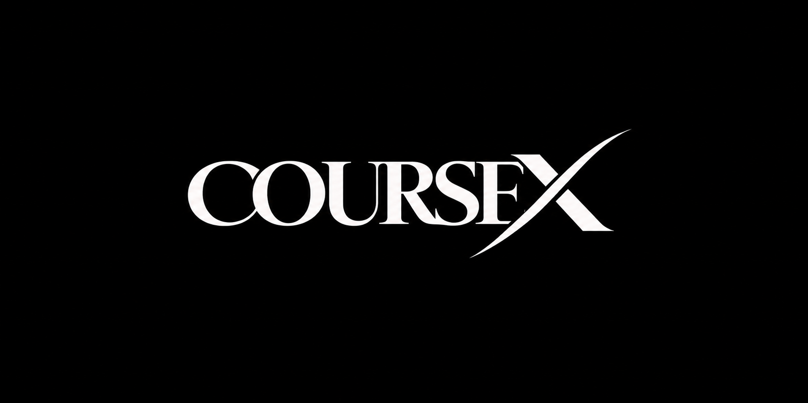

<p align="center">
  
</p>

<h1 align="center">CourseX</h1>

<p align="center">
  <strong>Next-Generation Cloud-Integrated Learning Experience Platform</strong>
</p>

<p align="center">
  <a href="https://coursex.pradhandj07.workers.dev/"></a>
  <a href="https://react.dev/"></a>
  <a href="https://vitejs.dev/"></a>
  <a href="https://workers.cloudflare.com/"></a>
  <a href="#license"></a>
</p>

---

## 🌟 Executive Summary

**CourseX** is an enterprise-grade learning platform engineered to transform fragmented video folders and cloud repositories into structured, distraction-free educational masterclasses. Built on modern web architecture and hosted globally across Cloudflare edge compute points, CourseX bridges the gap between raw cloud storage and polished, immersive learning.

Learners can seamlessly navigate multi-season courses, stream high-definition lectures, access synchronized study notes, and organize their educational journey through an ultra-responsive dark-glassmorphism interface.

> 🌐 **Experience the Live Application:** [https://coursex.pradhandj07.workers.dev/](https://coursex.pradhandj07.workers.dev/)

---

## ✨ Core Pillars & Learner Experience

### 1. 🎬 Cinematic, Distraction-Free Lecture Streaming
* **Integrated Media Console**: Direct in-app video streaming with synchronized curriculum progress.
* **Auto-Play & Lesson Sequences**: Seamless transition from one module to the next without leaving the player view.
* **Curriculum Sidebar**: Instant navigation across sections, chapters, durations, and lesson statuses.

### 2. 📁 Seamless Cloud Drive Integration
* **One-Click Folder Teleportation**: Jump straight from any syllabus module to the corresponding Google Drive storage folder for offline lecture downloads and shared assets.
* **Resource Syncing**: Direct access to slide decks, cheat sheets, starter repositories, and supplementary documentation.

### 3. 🔍 Intuitive Discovery & Catalog Exploration
* **Multi-Domain Taxonomy**: Browse engineering courses categorized across **Web Development**, **Artificial Intelligence**, **System Architecture**, **Mobile Engineering**, and **Cloud Computing**.
* **Instant Dynamic Filtering**: Zero-latency search and dynamic sorting by popularity, highest ratings, and release recency.
* **Course Previews & Metadata**: Real-world metrics including total watch time, lesson counts, verified student reviews, and prerequisite breakdowns.

### 4. 🛒 Frictionless Student Enrollment & Library
* **Personalized Course Library**: Enrolled masterclasses are indexed in the student’s personal dashboard for instantaneous access.
* **Intuitive Cart & Checkout Flow**: Sleek slide-out cart drawer with itemized billing breakdowns, discount voucher integration, and simulated instant enrollment.

### 5. 💎 Precision Craftsmanship & Visual Ergonomics
* **Dark-Glassmorphism Design System**: Custom HSL-tailored color palette accented with deep obsidian, metallic blues, and neon cyans.
* **Micro-Animations**: Fluid transitions, hover elevations, and dynamic glass blur effects engineered for peak visual satisfaction.
* **Responsive Layouts**: Flawless cross-device fidelity across ultra-wide monitors, laptops, tablets, and smartphones.

---

## 🏗️ System Architecture & Engineering

CourseX adheres to modern decoupled Single Page Application (SPA) architecture, optimizing for zero-latency interactions and instant edge asset delivery:

```
┌────────────────────────────────────────────────────────┐
│                   Cloudflare Edge CDN                  │
│       Global Anycast Network (300+ Edge Locations)     │
└───────────┬────────────────────────────────┬───────────┘
            │                                │
            ▼                                ▼
   ┌──────────────────┐            ┌──────────────────┐
   │ Client Assets    │            │ Cloudflare Worker│
   │ (HTML5/CSS3/JS)  │            │ SPA Fallback     │
   └────────┬─────────┘            └────────┬─────────┘
            │                                │
            └────────────────┬───────────────┘
                             ▼
              ┌─────────────────────────────┐
              │     CourseX React 19 Core   │
              │  • Context-Driven State     │
              │  • High-Fidelity UI Engine  │
              │  • Local Persistence Vault  │
              └─────────────────────────────┘
```

### 💻 Technology Matrix

| Layer | Technology | Rationale & Specifications |
| :--- | :--- | :--- |
| **Frontend Framework** | React 19 (`react` + `react-dom`) | Modern Concurrent Mode rendering and high-performance Virtual DOM. |
| **Build Bundler** | Vite 8.3 | Sub-second Hot Module Replacement (HMR) and optimized Tree-Shaking. |
| **Design System** | Tailored Vanilla CSS3 | Custom tokenized CSS variables, glassmorphic blurs, and zero utility bloat. |
| **Iconography** | Lucide React | Consistent, scalable vector graphics across all UI surfaces. |
| **State Management** | React Context API | Reactive decoupled stores for user session, active courses, and cart state. |
| **Deployment / Edge** | Cloudflare Workers | Serverless global delivery with 100% SLA uptime and SSL encryption. |

---

## 🚀 Getting Started

Follow these instructions to run CourseX locally in your development environment.

### Prerequisites
* **Node.js** (v18.0.0 or higher recommended)
* **npm** (v9.0.0 or higher)

### Installation & Local Setup

1. **Clone the repository:**
   ```bash
   git clone https://github.com/gravityyyy99/CourseX.git
   cd CourseX
   ```

2. **Install project dependencies:**
   ```bash
   npm install
   ```

3. **Launch the development server:**
   ```bash
   npm run dev
   ```
   Open your browser and navigate to `http://localhost:5173`.

4. **Compile for production:**
   ```bash
   npm run build
   ```

---

## 🌐 Global Edge Deployment

CourseX is configured for automatic deployment via Cloudflare Workers:

```bash
# Build the production bundle and deploy to Cloudflare Edge
npm run deploy
```

Any changes committed to the `main` branch on GitHub automatically trigger a continuous deployment pipeline through Cloudflare Git integration.

---

## 🔒 Security & Data Privacy

* **Client-First Privacy**: CourseX operates on strict client-side data isolation principles. User preferences, enrollment records, and active playback points remain securely bound to the client environment.
* **Encrypted Transport**: All platform traffic is strictly routed through Transport Layer Security (TLS 1.3 / HTTPS) at edge gateways.
* **Clean Code Standards**: Built according to modern ECMAScript standards with strict linting via Oxlint.

---

## 📄 License & Attribution

This project is open-source and distributed under the **MIT License**.

Designed and developed with dedication to premier digital craftsmanship.

<p align="center">
  <sub>Built for curious minds everywhere • CourseX Platform</sub>
</p>
